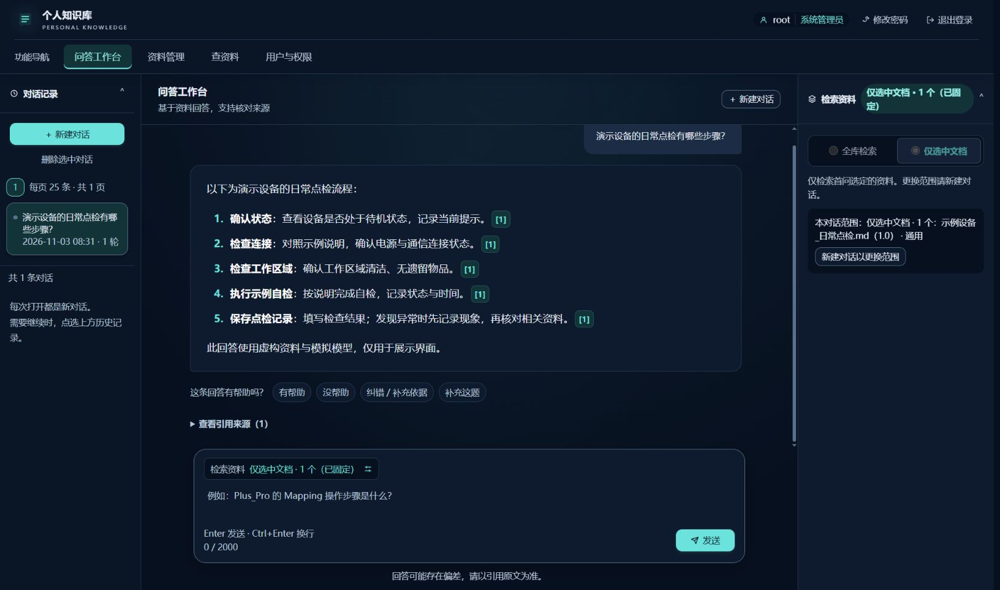
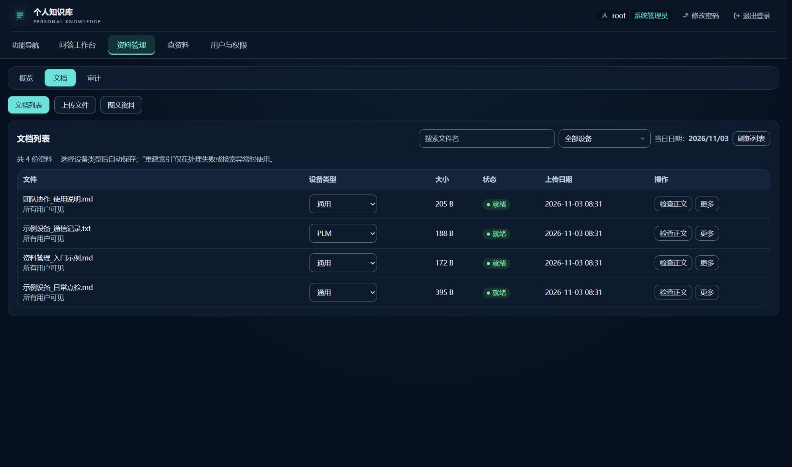
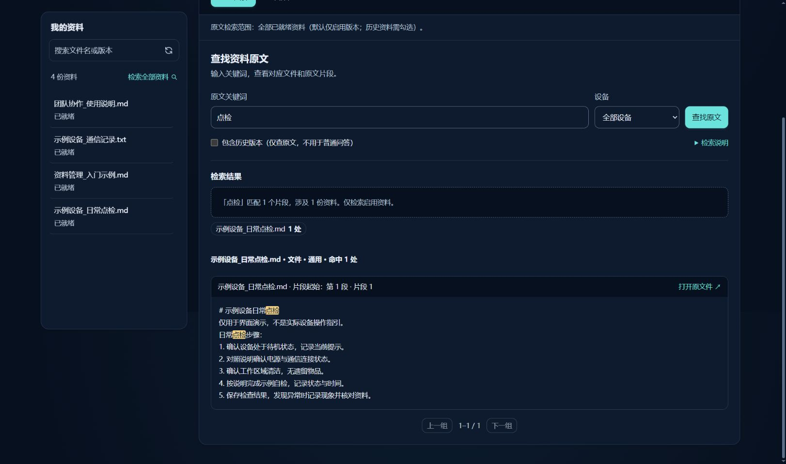
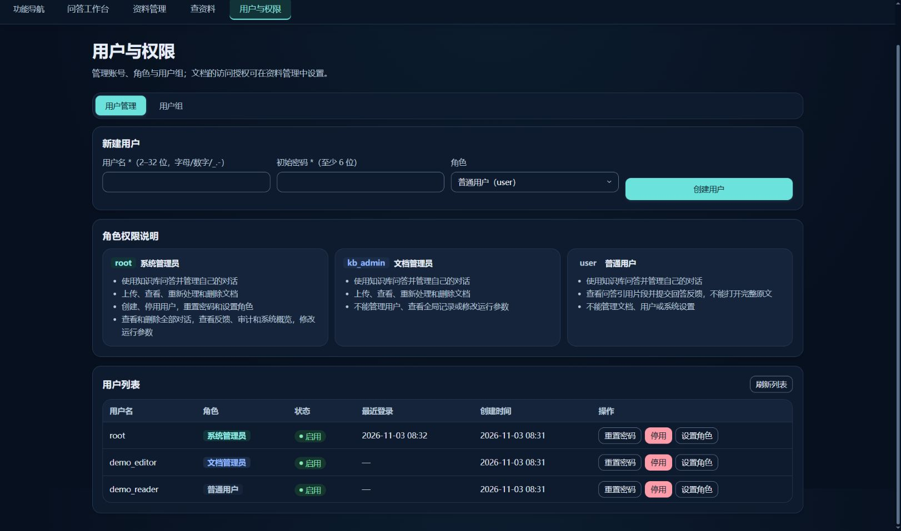

# Windows Personal Knowledge Base

Store manuals, spreadsheets and images locally, retrieve supporting passages, and use Ollama to answer with citations. [中文说明](README.md)

Status: **2026-11-02**. Production uses FastAPI/Jinja and vanilla JavaScript. Vue and visual redesign previews are not the production UI. Independent business acceptance is deferred; synthetic checks do not establish real-answer accuracy.

## Screenshots

Captured from an isolated demo using fictional accounts, sample documents and a mock answer. No local user data, private documents or image materials are included. Click an image to enlarge. These screenshots demonstrate the UI, not real-world answer accuracy.

| Chat, citations and history | Document management and device metadata |
| --- | --- |
| [](docs/screenshots/chat.jpg) | [](docs/screenshots/documents.jpg) |
| **Keyword search and source passages** | **Users, roles and groups** |
| [](docs/screenshots/source-search.jpg) | [](docs/screenshots/users.jpg) |

[Capture notes](docs/screenshots/README.md)

## Start

Install Git for Windows, Python 3.12 and Ollama, then run:

```powershell
git clone https://github.com/ihyh/lan-rag-pilot.git C:\rag
cd C:\rag
.\setup_windows.cmd
```

Setup installs dependencies and models, generates configuration and an initial root password. Save the password shown by setup. Open `http://127.0.0.1:8088`. Subsequent starts use `start_windows.cmd`. Defaults are Ollama `qwen3:4b-instruct` and CPU BGE-small-zh-v1.5; existing configuration is retained. See the [Windows guide](docs/WINDOWS.md).

## Current capabilities

- Chat: accessible corpus or selected documents, device shortcuts, streaming answers, source inspection, feedback, and conversation history with 25 items per page.
- Documents: upload, image descriptions, OCR review, device metadata, versions, lifecycle, access grants, inspection, reindexing and deletion.
- Source search: literal keyword matching in indexed text and document inspection without answer generation.
- Separate users and permissions page: root manages accounts, roles and groups; retrieval and source access enforce document permissions.
- Feedback review: helpful feedback needs no review; issue feedback supports corrections, processing notes, manually selected sources and optional frozen replay metadata.
- Management navigation supports deep links, reload and browser back/forward.

Inputs include PDF, DOCX, XLSX, TXT, Markdown and PNG/JPEG. Legacy DOC needs antiword. Image analysis requires a configured vision model and human verification. Device shortcuts use metadata rather than filename guesses.

Web/log import, feedback export buttons and the MCP service are no longer supplied. Compatibility readers for older sources may remain. Automatic reuse of historical answers is not implemented.

## Development checks

Use Python 3.12 and Node.js 24 in an isolated environment:

```powershell
python -m pip install -r requirements-smoke.txt
python tests/run_checks.py
npm ci --prefix tests/ui
npm test --prefix tests/ui
powershell.exe -NoProfile -ExecutionPolicy Bypass -File tests/smoke_runner.ps1 -Python (Get-Command python).Source
```

Smoke tests use temporary data, mock models and ports 8090/8099, including persistence after restart. DOM tests are not visual acceptance. Optional OCR checks report missing dependencies as skips. Real-answer evaluation requires independently reviewed questions and source evidence; see the [evaluation workflow](eval/BUSINESS_EVAL_WORKFLOW.md).

Before updating, stop the service and back up complete `data` and `.env`. Save the revision, use `git pull --ff-only`, and run setup again. Do not overwrite local changes. Code updates do not automatically reparse existing documents.

Private documents, credentials, databases, weights and previews are excluded. Use private HTTPS access rather than public exposure. One worker is supported; SSO, MFA and enterprise high availability are not supplied. See [operations](docs/OPERATIONS.md), [security](docs/SECURITY.md), [documentation](docs/README.md) and [roadmap](ROADMAP.md).
