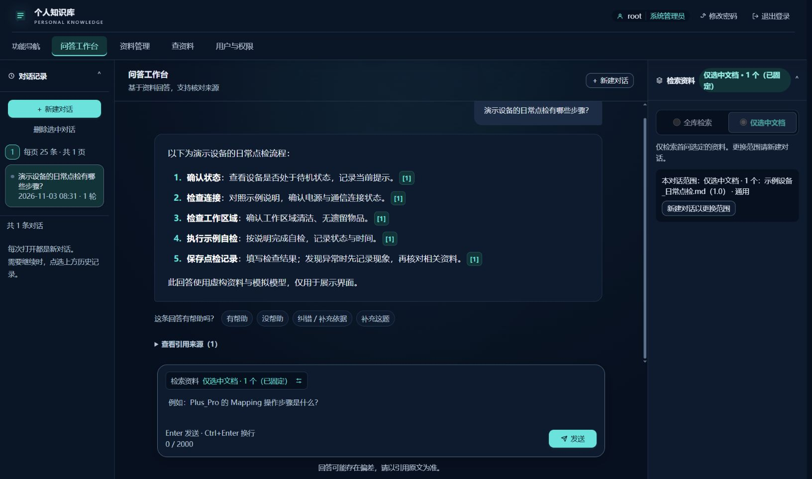
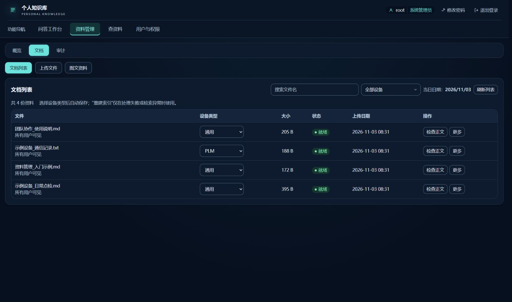
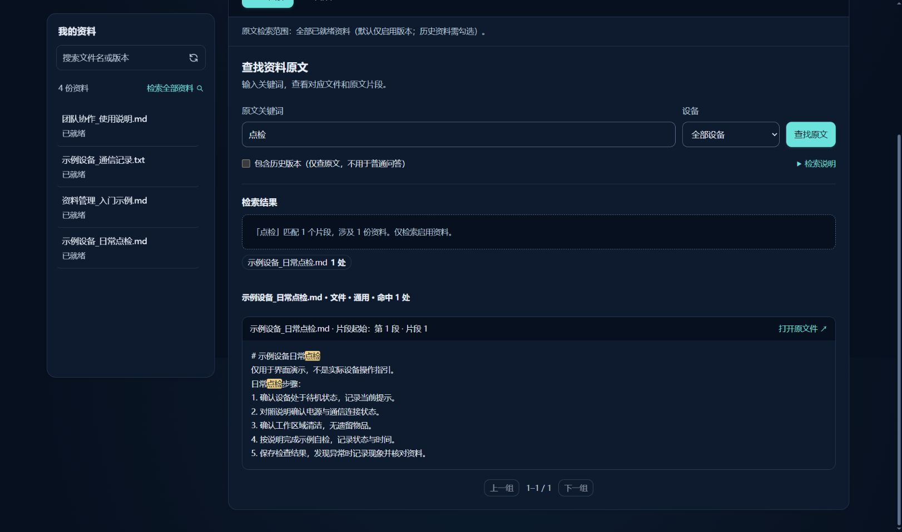
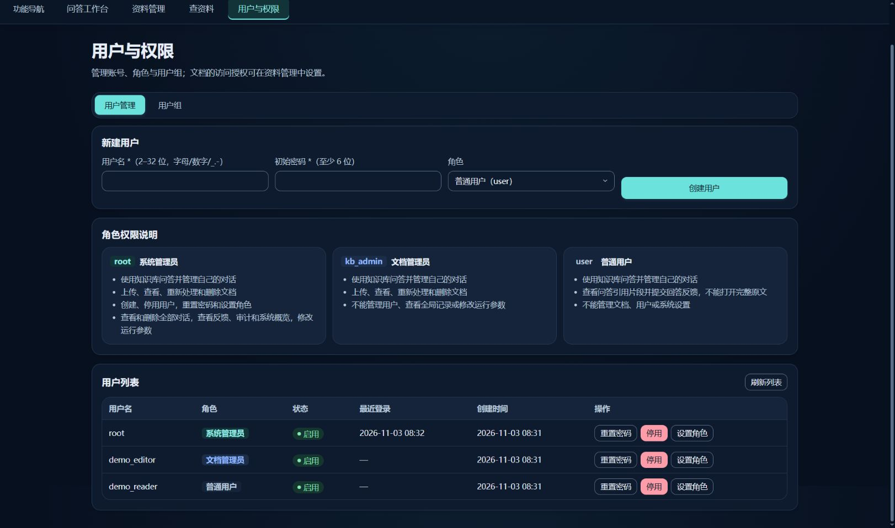

# 个人知识库 · 设备资料查询与问答

这是一个运行在 Windows 电脑上的资料查询网页。你可以上传设备手册、通信协议、故障代码表和接线图，再直接提问，例如：“这台设备怎么做点检？”“这个报警是什么意思？”

系统从你上传的资料中查找相关内容，用 Ollama 生成回答，并列出引用的文件和原文片段。你也可以跳过问答，直接搜索资料中的关键词。[English](README.en.md)

## 具体能做什么

| 你要做的事 | 页面里的操作 |
| --- | --- |
| 查某台设备的操作方法或故障说明 | 在“问答工作台”选择设备或指定文档，再输入问题 |
| 确认回答依据 | 展开回答下方的引用，查看文件名和原文片段；有权限的用户可打开原文件 |
| 找协议指令、参数名或报警代码 | 在“查资料”输入关键词，查看匹配的原文及位置，不生成回答 |
| 整理手册、扫描件和接线图 | 在“资料管理”上传文件、标注设备；扫描件核对识别文字，图片可填写说明 |
| 查看以前的问答、记录错误 | 翻页查看历史对话；对回答提交反馈，由管理员填写核对结果和处理记录 |
| 给同事使用并限制资料范围 | 管理员创建账号、设置角色和用户组，为文档分配访问权限 |

支持 PDF、Word（DOCX）、Excel（XLSX）、TXT、Markdown 和 PNG/JPEG。扫描件与图片识别结果需人工核对，回答是否正确也应以原文为准。

## 界面预览

以下为虚构资料与模拟回答的演示截图，点击可放大。

| 问答工作台：回答、引用与历史 | 资料管理：设备类型与文档操作 |
| --- | --- |
| [](docs/screenshots/chat.jpg) | [](docs/screenshots/documents.jpg) |
| **原文检索：关键词与命中片段** | **用户与权限：账号、角色与用户组** |
| [](docs/screenshots/source-search.jpg) | [](docs/screenshots/users.jpg) |

## 快速开始

在 Windows 10/11 上安装 Git、Python 3.12 和 [Ollama](https://ollama.com/download/windows)，并启动 Ollama。然后在 PowerShell 中运行：

```powershell
git clone https://github.com/ihyh/lan-rag-pilot.git C:\rag
cd C:\rag
.\setup_windows.cmd
```

首次安装需要联网下载依赖和模型。请保存安装时显示的 `root` 初始密码。

打开 **http://127.0.0.1:8088**，用 `root` 登录。在“资料管理”上传文件，状态显示“就绪”后，进入“问答工作台”提问。

以后启动，在安装目录双击 `start_windows.cmd` 即可。

## 数据说明

资料和对话默认保存在本机。仓库不包含个人账号、文档或数据库。更新前请备份 `data` 文件夹和 `.env` 配置。

## 使用帮助

[安装与手机访问](docs/WINDOWS.md) · [首次使用](docs/GETTING_STARTED.md) · [模型设置](docs/MODELS.md) · [备份与更新](docs/OPERATIONS.md) · [常见问题](docs/TROUBLESHOOTING.md) · [全部文档](docs/README.md)
